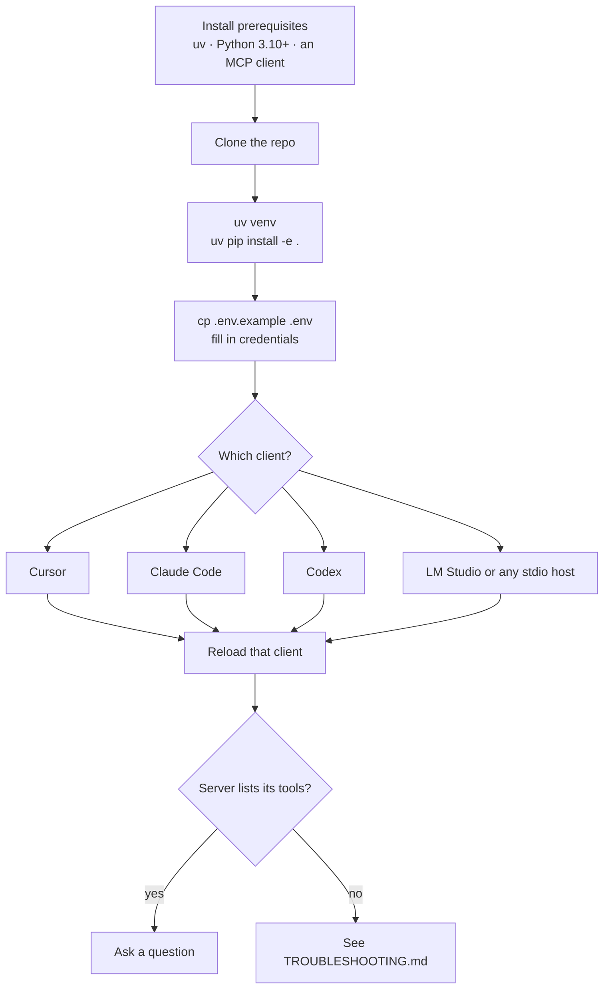

# Installing csw-mcp

A step-by-step guide to get `csw-mcp` running against your cluster in under 10
minutes.

Pick the page for the laptop you have and skip the generic install:

- [Cisco field Mac](#cisco-field-mac)
- [Windows](#windows)
- [Linux](#linux)

None of these need administrator rights for the server itself. Each one installs
`uv` into your home directory and tells the client the full path, because an
app opened from the Dock, the Start menu, or a desktop launcher does not load
your shell startup file. On a Cisco laptop, TLS inspection means `uv` must use
the system certificate store, and Python still may not.

## Install sequence



## Cisco field Mac

Do this in Terminal. The Cisco laptop's shell is zsh. You do not need
Homebrew, sudo, or a software-catalog ticket for the server itself. Cursor,
Claude Code, Codex, or LM Studio still come from the vendor or from Self
Service if the browser download is blocked.

### 1. Put the tools in your home directory

```bash
curl -LsSf https://astral.sh/uv/install.sh | sh
```

macOS `curl` uses the Keychain, so this download usually works behind the
Cisco proxy. Add `uv` to your shell, and tell later `uv` commands to trust
the certificate already installed on the laptop
([`UV_SYSTEM_CERTS`](https://docs.astral.sh/uv/reference/environment/#uv_system_certs)):

```bash
cat >> ~/.zshrc <<'EOF'
export PATH="$HOME/.local/bin:$PATH"
export UV_SYSTEM_CERTS=true
EOF
source ~/.zshrc
which uv
```

`which uv` should print `/Users/<your-cec>/.local/bin/uv`. If macOS says the
program is damaged or from an unidentified developer, clear the download
quarantine on that file only:

```bash
xattr -d com.apple.quarantine "$HOME/.local/bin/uv"
```

### 2. Clone and install

Keep the checkout in your home directory. A path with spaces makes the client
config harder.

```bash
mkdir -p "$HOME/code"
git clone https://github.com/chandrapati/csw-mcp.git "$HOME/code/csw-mcp"
cd "$HOME/code/csw-mcp"
uv venv
uv pip install -e .
```

`uv venv` downloads Python into the checkout. `UV_SYSTEM_CERTS=true` is what
lets that download succeed when the laptop is intercepting TLS. If `git clone`
fails on a certificate, the system `git` is not using the Keychain:

```bash
git config --global http.sslBackend secure-transport
```

### 3. Create the API key in the cluster, not on the laptop

Open the cluster URL in the browser. If the page does not load, connect Cisco
Secure Client and try again. A SaaS tenant on `*.tetrationcloud.com` is
reached over the internet. An on-premises cluster is reachable only on the
network or VPN where that cluster lives.

In the UI: **User Menu → API Keys → Create API Key**. The key needs
`sensor_management`, `flow_inventory_query`, and `app_policy_management`.
Copy the key and the secret once. They are not stored in the UI again.

```bash
cp .env.example .env
```

Edit `.env`:

```bash
CSW_API_URL=https://your-cluster.tetrationcloud.com
CSW_API_KEY=<hex key>
CSW_API_SECRET=<hex secret>
```

Leave `CSW_VERIFY_SSL` unset and try the verify step below. Python does not
read the Mac Keychain, so a call from this server can fail with
`CERTIFICATE_VERIFY_FAILED` even though the browser works. If that happens,
add this one line to `.env`:

```bash
CSW_VERIFY_SSL=false
```

That skips TLS verification for this server only. Do not commit `.env`.

### 4. Register the client with the full path to uv

An app opened from the Dock does not load `~/.zshrc`, so `command: "uv"`
fails. Use `/Users/<your-cec>/.local/bin/uv`.

Cursor, from the checkout:

```bash
bash scripts/install-cursor.sh
```

The script writes that absolute path into `~/.cursor/mcp.json`. Quit Cursor
completely and open it again. Reloading the window is not enough if Cursor
was already running.

Claude Code:

```bash
claude mcp add --transport stdio --scope user csw-mcp -- \
  "$HOME/.local/bin/uv" run --directory "$HOME/code/csw-mcp" csw-mcp
```

Then `claude mcp list`, start Claude Code, and run `/mcp`.

Codex:

```bash
codex mcp add csw-mcp -- \
  "$HOME/.local/bin/uv" run --directory "$HOME/code/csw-mcp" csw-mcp
```

Then `codex mcp list`, or `/mcp` in the Codex terminal UI.

LM Studio 0.3.17 or newer: Program → Install → Edit `mcp.json`. The loaded
model has to support tool calling.

```json
{
  "mcpServers": {
    "csw-mcp": {
      "command": "/Users/<your-cec>/.local/bin/uv",
      "args": ["run", "--directory", "/Users/<your-cec>/code/csw-mcp", "csw-mcp"]
    }
  }
}
```

### 5. Confirm it from Terminal first

```bash
cd "$HOME/code/csw-mcp"
uv run python -c "from csw_mcp import config; print(config.missing_vars())"
uv run python -c "from csw_mcp.server import mcp; print('tools:', len(mcp._tool_manager._tools))"
```

The first command prints `[]` when `.env` is complete. The second prints the
tool count. Then ask the client: "Summarize my CSW cluster posture."

## Windows

Use PowerShell. You do not need an elevated prompt. Cursor, Claude Code,
Codex, or LM Studio still come from the vendor or from the software catalog if
the browser download is blocked.

### 1. Put uv in your user profile

```powershell
powershell -ExecutionPolicy ByPass -c "irm https://astral.sh/uv/install.ps1 | iex"
```

The installer places `uv.exe` in `%USERPROFILE%\.local\bin` and can add that
directory to your user PATH. Close that PowerShell window and open a new one
so the new PATH is visible. Then trust the certificate store already on the
laptop:

```powershell
[System.Environment]::SetEnvironmentVariable("UV_SYSTEM_CERTS", "true", "User")
$env:UV_SYSTEM_CERTS = "true"
uv --version
```

`uv --version` should print a version. The program path is
`C:\Users\<you>\.local\bin\uv.exe`.

### 2. Clone and install

Git for Windows is required for `git clone`. If `git` is not installed and you
cannot add it, download the repository zip from GitHub and unpack it to
`C:\Users\<you>\code\csw-mcp`. Avoid a path with spaces.

```powershell
New-Item -ItemType Directory -Force -Path "$env:USERPROFILE\code" | Out-Null
git clone https://github.com/chandrapati/csw-mcp.git "$env:USERPROFILE\code\csw-mcp"
Set-Location "$env:USERPROFILE\code\csw-mcp"
uv venv
uv pip install -e .
```

`UV_SYSTEM_CERTS=true` is what lets `uv` download Python through a Cisco TLS
proxy. The Windows certificate store already has that proxy's root. Python,
which this server uses for cluster calls, does not read that store.

### 3. Create the API key in the cluster, not on the laptop

Open the cluster URL in the browser. If the page does not load, connect Cisco
Secure Client and try again. A SaaS tenant on `*.tetrationcloud.com` is
reached over the internet. An on-premises cluster is reachable only on the
network or VPN where that cluster lives.

In the UI: **User Menu → API Keys → Create API Key**. The key needs
`sensor_management`, `flow_inventory_query`, and `app_policy_management`.

```powershell
Copy-Item .env.example .env
notepad .env
```

Set `CSW_API_URL`, `CSW_API_KEY`, and `CSW_API_SECRET`. Leave
`CSW_VERIFY_SSL` unset and try the confirm step. If the call fails with
`CERTIFICATE_VERIFY_FAILED`, add this line to `.env`:

```bash
CSW_VERIFY_SSL=false
```

That skips TLS verification for this server only. Do not commit `.env`.

### 4. Register the client with uv.exe

Cursor on Windows reads `%USERPROFILE%\.cursor\mcp.json`. Do not point
`command` at a Git Bash path such as `/c/Users/...`. Cursor cannot launch
that. Use the `.exe` path, with forward slashes so the JSON does not need
escaped backslashes:

```json
{
  "mcpServers": {
    "csw-mcp": {
      "command": "C:/Users/<you>/.local/bin/uv.exe",
      "args": ["run", "--directory", "C:/Users/<you>/code/csw-mcp", "csw-mcp"]
    }
  }
}
```

Quit Cursor completely and open it again.

`scripts/install-cursor.sh` works from Git Bash and converts `uv` with
`cygpath -w` when that command exists. From PowerShell, paste the JSON above.

Claude Code:

```powershell
claude mcp add --transport stdio --scope user csw-mcp -- `
  "$env:USERPROFILE\.local\bin\uv.exe" run --directory "$env:USERPROFILE\code\csw-mcp" csw-mcp
```

Then `claude mcp list`, start Claude Code, and run `/mcp`.

Codex:

```powershell
codex mcp add csw-mcp -- `
  "$env:USERPROFILE\.local\bin\uv.exe" run --directory "$env:USERPROFILE\code\csw-mcp" csw-mcp
```

Then `codex mcp list`, or `/mcp` in the Codex terminal UI. The same file is
`%USERPROFILE%\.codex\config.toml`.

LM Studio 0.3.17 or newer: Program → Install → Edit `mcp.json`, and paste the
same JSON as Cursor. The loaded model has to support tool calling.

### 5. Confirm it from PowerShell first

```powershell
Set-Location "$env:USERPROFILE\code\csw-mcp"
uv run python -c "from csw_mcp import config; print(config.missing_vars())"
uv run python -c "from csw_mcp.server import mcp; print('tools:', len(mcp._tool_manager._tools))"
```

The first command prints `[]` when `.env` is complete. Then ask the client:
"Summarize my CSW cluster posture."

## Linux

Use a terminal. You do not need `sudo` or Homebrew. The shell may be bash or
zsh. Cursor, Claude Code, Codex, or LM Studio still come from the vendor or
from the software catalog if the download is blocked.

### 1. Put uv in your home directory

```bash
curl -LsSf https://astral.sh/uv/install.sh | sh
```

Add it to the startup file your shell actually reads (`~/.bashrc` for bash,
`~/.zshrc` for zsh), and tell `uv` to use the system certificate store:

```bash
cat >> ~/.bashrc <<'EOF'
export PATH="$HOME/.local/bin:$PATH"
export UV_SYSTEM_CERTS=true
EOF
source ~/.bashrc
which uv
```

`which uv` should print `/home/<you>/.local/bin/uv`. A desktop app still will
not see this PATH. The client config below uses the full path for that reason.

### 2. Clone and install

```bash
mkdir -p "$HOME/code"
git clone https://github.com/chandrapati/csw-mcp.git "$HOME/code/csw-mcp"
cd "$HOME/code/csw-mcp"
uv venv
uv pip install -e .
```

If `git clone` fails on a certificate, the corporate root is not in the bundle
`git` is using. Install that root through the laptop's certificate package, or
point `git` at the system bundle:

```bash
git config --global http.sslCAInfo /etc/ssl/certs/ca-certificates.crt
```

That path is the Debian and Ubuntu bundle. On Fedora and RHEL it is
`/etc/pki/tls/certs/ca-bundle.crt`.

### 3. Create the API key in the cluster, not on the laptop

Open the cluster URL in a browser. If the page does not load, connect Cisco
Secure Client and try again. A SaaS tenant on `*.tetrationcloud.com` is
reached over the internet. An on-premises cluster is reachable only on the
network or VPN where that cluster lives.

In the UI: **User Menu → API Keys → Create API Key**. The key needs
`sensor_management`, `flow_inventory_query`, and `app_policy_management`.

```bash
cp .env.example .env
```

Set `CSW_API_URL`, `CSW_API_KEY`, and `CSW_API_SECRET`. Leave
`CSW_VERIFY_SSL` unset and try the confirm step. Python does not use the
system bundle unless you point it there. If the call fails with
`CERTIFICATE_VERIFY_FAILED`, add this line to `.env`:

```bash
CSW_VERIFY_SSL=false
```

That skips TLS verification for this server only. Do not commit `.env`.

### 4. Register the client with the full path to uv

From the checkout, Cursor:

```bash
bash scripts/install-cursor.sh
```

The script writes `~/.cursor/mcp.json` with the absolute path of `uv`. Quit
Cursor completely and open it again.

Claude Code:

```bash
claude mcp add --transport stdio --scope user csw-mcp -- \
  "$HOME/.local/bin/uv" run --directory "$HOME/code/csw-mcp" csw-mcp
```

Then `claude mcp list`, start Claude Code, and run `/mcp`.

Codex:

```bash
codex mcp add csw-mcp -- \
  "$HOME/.local/bin/uv" run --directory "$HOME/code/csw-mcp" csw-mcp
```

Then `codex mcp list`, or `/mcp` in the Codex terminal UI.

LM Studio 0.3.17 or newer: Program → Install → Edit `mcp.json`. The loaded
model has to support tool calling.

```json
{
  "mcpServers": {
    "csw-mcp": {
      "command": "/home/<you>/.local/bin/uv",
      "args": ["run", "--directory", "/home/<you>/code/csw-mcp", "csw-mcp"]
    }
  }
}
```

### 5. Confirm it from a terminal first

```bash
cd "$HOME/code/csw-mcp"
uv run python -c "from csw_mcp import config; print(config.missing_vars())"
uv run python -c "from csw_mcp.server import mcp; print('tools:', len(mcp._tool_manager._tools))"
```

The first command prints `[]` when `.env` is complete. Then ask the client:
"Summarize my CSW cluster posture."

## 1. Prerequisites

| Tool | Why | Install |
|------|-----|---------|
| **uv** | Project toolchain (env + packaging) | `curl -LsSf https://astral.sh/uv/install.sh \| sh` |
| **Python 3.10+** | Runtime | uv can manage this for you |
| **An MCP client** | Starts this server and gives the model its tools | Cursor, Claude Code, Codex, or LM Studio 0.3.17+ |
| **CSW API key** | Cluster access | CSW UI → User Menu → API Keys |

Your API key needs these read capabilities:
`sensor_management`, `flow_inventory_query`, `app_policy_management`.

## 2. Clone

```bash
git clone https://github.com/chandrapati/csw-mcp.git
cd csw-mcp
```

## 3. Install

```bash
uv venv
uv pip install -e .
```

This creates `.venv/` and installs the `csw-mcp` console script.

## 4. Configure credentials

```bash
cp .env.example .env
```

Edit `.env`:

```bash
CSW_API_URL=https://your-cluster.tetrationcloud.com
CSW_API_KEY=<hex key from the CSW UI>
CSW_API_SECRET=<hex secret from the CSW UI>
# CSW_VERIFY_SSL=false   # only behind a TLS-inspecting corporate proxy
```

> `.env` is git-ignored. Never commit real credentials.

## 5. Wire it into a client

`csw-mcp` is a local stdio server. The model never talks to the cluster itself.
The client starts this process and passes tool calls to it. Credentials stay in
the repo `.env`. Do not paste the API key or secret into a client config.

Every client below runs the same command. Replace the path with your checkout:

```bash
uv run --directory /abs/path/to/csw-mcp csw-mcp
```

`--directory` is what makes the server load that checkout's `.env`.

### Cursor

```bash
bash scripts/install-cursor.sh
```

That writes `~/.cursor/mcp.json`. `command` is the full path to `uv`:

```json
{
  "mcpServers": {
    "csw-mcp": {
      "command": "/Users/you/.local/bin/uv",
      "args": ["run", "--directory", "/abs/path/to/csw-mcp", "csw-mcp"]
    }
  }
}
```

`install-cursor.sh` writes the absolute path of `uv`, not the bare command.
That is required on a Cisco Mac when Cursor is opened from the Dock. Quit
Cursor completely and open it again. Docs: https://cursor.com/docs/mcp

### Claude Code

From the checkout, register it for your user (so every project can see it):

```bash
claude mcp add --transport stdio --scope user csw-mcp -- \
  uv run --directory /abs/path/to/csw-mcp csw-mcp
```

Use `--scope project` instead if you want it only in this repo. That writes
`.mcp.json`, which you can commit only if the path is not personal. Confirm
with `claude mcp list`, then start a session and run `/mcp`.

Docs: https://code.claude.com/docs/en/mcp

### Codex

Codex CLI, the Codex IDE extension, and the ChatGPT desktop app share one
config. From the checkout:

```bash
codex mcp add csw-mcp -- uv run --directory /abs/path/to/csw-mcp csw-mcp
```

Or add this to `~/.codex/config.toml` (a trusted project can use
`.codex/config.toml` instead):

```toml
[mcp_servers.csw-mcp]
command = "uv"
args = ["run", "--directory", "/abs/path/to/csw-mcp", "csw-mcp"]
```

In the Codex terminal UI, `/mcp` lists the server. `codex mcp list` does the
same from a shell.

Docs: https://learn.chatgpt.com/docs/extend/mcp.md

### LM Studio, and any other local model

LM Studio 0.3.17 and later is an MCP host. The model you load still has to
support tool calling. A chat-only model will not call these tools.

Open the Program tab in the right sidebar, then **Install → Edit mcp.json**,
and add the same entry Cursor uses. On a Cisco Mac, `command` has to be the full path:

```json
{
  "mcpServers": {
    "csw-mcp": {
      "command": "/Users/you/.local/bin/uv",
      "args": ["run", "--directory", "/abs/path/to/csw-mcp", "csw-mcp"]
    }
  }
}
```

Docs: https://lmstudio.ai/docs/app/mcp

Any other host that can launch a stdio MCP server (Claude Desktop, another
agent app, a local OpenAI-compatible client with MCP) uses that same `command`
and `args`. If the host has no MCP client, pointing it at a model in LM Studio
does not attach this server. The host has to start `csw-mcp`.

## 6. Verify

In a terminal, from the checkout:

```bash
uv run python -c "from csw_mcp.server import mcp; print('tools:', len(mcp._tool_manager._tools), 'prompts:', len(mcp._prompt_manager._prompts))"
# tools: 26 prompts: 3
```

After the client reloads, `csw-mcp` should list its tools (`list_scopes`,
`list_sensors`, `summarize_cluster_posture`, and the rest).

Then ask:

> **"Summarize my CSW cluster posture."**

You should get a KPI summary (enforcing vs. visibility agents, coverage %, scope
count) — not raw JSON.

## Optional: live smoke test

Exercise every tool against your own cluster:

```bash
uv run python tests/test_tools_live.py
# PASS  list_scopes  …
# 26/26 tools returned without raising.
```

Having trouble? See **[TROUBLESHOOTING.md](TROUBLESHOOTING.md)**.
